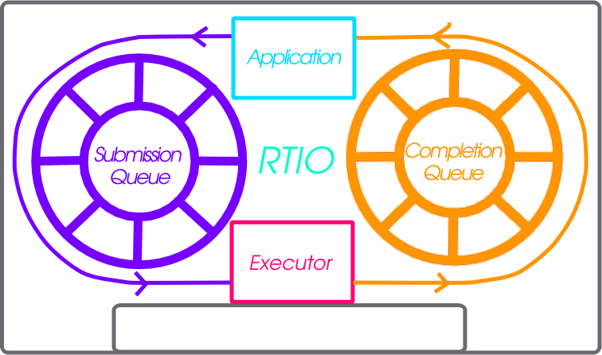

.. _rtio:

Real Time I/O (RTIO)
####################

.. contents::
  :local:
  :depth: 2

RTIO provides a framework for doing asynchronous operation chains with event
driven I/O. This section covers the RTIO API, queues, executor, iodev,
and common usage patterns with peripheral devices.

RTIO takes a lot of inspiration from Linux's io_uring in its operations and API
as that API matches up well with hardware transfer queues and descriptions such as
DMA transfer lists.

Problem
*******

An application wishing to do complex DMA or interrupt driven operations today
in Zephyr requires direct knowledge of the hardware and how it works. There is
no understanding in the DMA API of other Zephyr devices and how they relate.

This means doing complex audio, video, or sensor streaming requires direct
hardware knowledge or leaky abstractions over DMA controllers. Neither is ideal.

To enable asynchronous operations, especially with DMA, a description of what
to do rather than direct operations through C and callbacks is needed. Enabling
DMA features such as channels with priority, and sequences of transfers requires
more than a simple list of descriptions.

Using DMA and/or interrupt driven I/O shouldn't dictate whether or not the
call is blocking or not.

Inspiration, introducing io_uring
*********************************

It's better not to reinvent the wheel (or ring in this case) and io_uring as an
API from the Linux kernel provides a winning model. In io_uring there are two
lock-free ring buffers acting as queues shared between the kernel and a userland
application. One queue for submission entries which may be chained and flushed to
create concurrent sequential requests. A second queue for completion queue events.
Only a single syscall is actually required to execute many operations, the
io_uring_submit call. This call may block the caller when a number of
operations to wait on is given.

This model maps well to DMA and interrupt driven transfers. A request to do a
sequence of operations in an asynchronous way directly relates
to the way hardware typically works with interrupt driven state machines
potentially involving multiple peripheral IPs like bus and DMA controllers.

Submission Queue
****************

The submission queue (sq), is the description of the operations
to perform in concurrent chains.

For example imagine a typical SPI transfer where you wish to write a
register address to then read from. So the sequence of operations might be...

   1. Chip Select
   2. Clock Enable
   3. Write register address into SPI transmit register
   4. Read from the SPI receive register into a buffer
   5. Disable clock
   6. Disable Chip Select

If anything in this chain of operations fails give up. Some of those operations
can be embodied in a device abstraction that understands a read or write
implicitly means setup the clock and chip select. The transactional nature of
the request also needs to be embodied in some manner. Of the operations above
perhaps the read could be done using DMA as its large enough make sense. That
requires an understanding of how to setup the device's particular DMA to do so.

The above sequence of operations is embodied in RTIO as chain of
submission queue entries (sqe). Chaining is done by setting a bitflag in
an sqe to signify the next sqe must wait on the current one.

Because the chip select and clocking is common to a particular SPI controller
and device on the bus it is embodied in what RTIO calls an iodev.

Multiple operations against the same iodev are done in the order provided as
soon as possible. If two operation chains have varying points using the same
device its possible one chain will have to wait for another to complete.

Completion Queue
****************

In order to know when a sqe has completed there is a completion
queue (cq) with completion queue events (cqe). A sqe once completed results in
a cqe being pushed into the cq. The ordering of cqe may not be the same order of
sqe. A chain of sqe will however ensure ordering and failure cascading.

Every submission reaches the completion queue, whatever its outcome. One that
runs reports the result its iodev gave, one that fails reports the error, and
one stopped by a cancellation reports ``-ECANCELED``. The only exception is
:c:macro:`RTIO_SQE_NO_RESPONSE`, which says a submission wants no completion
at all, however it finishes. A caller can therefore account for every
submission it queued without that flag, which is what makes waiting on a count
of them, as :c:func:`rtio_submit` does with a non-zero ``wait_count``, safe.
A transaction is one unit of work to its iodev but several submissions, so it
produces one completion per member rather than one for the set.

Other potential schemes are possible but a completion queue is a well trod
idea with io_uring and other similar operating system APIs.

Executor
********

The RTIO executor is a low overhead concurrent I/O task scheduler. It ensures
certain request flags provide the expected behavior. It takes a list of
submissions working through them in order. Various flags allow for changing the
behavior of how submissions are worked through. Flags to form in order chains of
submissions, transactional sets of submissions, or create multi-shot
(continuously producing) requests are all possible!

IO Device
*********

Turning submission queue entries (sqe) into completion queue events (cqe) is the
job of objects implementing the iodev (IO device) API. This API accepts requests
in the form of the iodev submit API call. It is the io devices job to work
through its internal queue of submissions and convert them into completions. In
effect every io device can be viewed as an independent, event driven actor like
object, that accepts a never ending queue of I/O like requests. How the iodev
does this work is up to the author of the iodev, perhaps the entire queue of
operations can be converted to a set of DMA transfer descriptors, meaning the
hardware does almost all of the real work.

Cancellation
************

Canceling an already queued operation is possible but not guaranteed. If the
SQE has not yet started, it's likely that a call to :c:func:`rtio_sqe_cancel`
will remove the SQE and never run it. If, however, the SQE already started
running, the cancel request will be ignored.

A canceled submission is not a submission that disappears. It completes like
any other, under the rule described in `Completion Queue`_. One that is
stopped reports ``-ECANCELED`` and its own userdata, and cancellation then
cascades along a chain the way a failure does, so the submissions behind it
are canceled too and each reports its own ``-ECANCELED``. One that beat the
cancellation reports whatever its iodev produced, so read ``cqe->result``
rather than assume.

Deadlines
*********

.. TODO(final writing): the headings, diagrams, table and code below are the
   skeleton. The prose under each heading is a draft to rewrite in your own
   words, and the ``TODO`` comments say what is missing. Remove every ``TODO``
   comment before submitting.

.. TODO: intro paragraph. Points worth making somewhere in it:

   * a chain says in what order work runs, not how long it may take; a deadline
     is how that is bounded
   * the deadline is a submission like any other, with a handle and a
     completion, rather than a field on every submission, so nothing is paid
     for by submissions that never use one
   * contrast with io_uring's ``IORING_OP_LINK_TIMEOUT``, which trails the
     request it guards, if you want the comparison here

A deadline is prepared with :c:func:`rtio_sqe_prep_deadline` and carries
:c:macro:`RTIO_SQE_CHAINED` like any chain head. It guards the submissions
behind it:

.. code-block:: c

   struct rtio_sqe *sqe;

   sqe = rtio_sqe_acquire(r);
   rtio_sqe_prep_deadline(sqe, K_MSEC(50), DEADLINE_UD);
   sqe->flags |= RTIO_SQE_CHAINED;

   sqe = rtio_sqe_acquire(r);
   rtio_sqe_prep_write(sqe, iodev, RTIO_PRIO_NORM, &reg, sizeof(reg), WRITE_UD);
   sqe->flags |= RTIO_SQE_CHAINED;

   sqe = rtio_sqe_acquire(r);
   rtio_sqe_prep_read(sqe, iodev, RTIO_PRIO_NORM, buf, sizeof(buf), READ_UD);

   /* Three submissions, so three completions: the two members and the deadline */
   rtio_submit(r, 3);

.. mermaid::
   :caption: A chain guarded by a deadline
   :alt: The deadline heads the chain and links to the write, the write links
         to the read, and the read is the last member. A dotted link runs from
         the read back to the deadline, which is how the chain reaches its
         deadline and how the deadline reaches its members.

   ---
   config:
     flowchart:
       useMaxWidth: false
   ---
   flowchart LR
       dl["deadline K_MSEC(50)"]
       w["write"]
       r["read"]

       dl -->|CHAINED| w
       w -->|CHAINED| r
       r -.->|ends the chain| dl

       classDef guard stroke-width:2px,stroke-dasharray:4
       class dl guard

.. TODO: a sentence on what the dotted link is for, if the caption is not
   enough. It is what lets the chain find its deadline when it ends, and what
   lets the deadline walk the members it still owns when it elapses.

Arming
======

A deadline is not a step in the chain it heads. Holding the chain up until the
deadline elapsed would be the opposite of guarding it, so dispatching the
deadline arms it and starts the next submission at once; the two then run
alongside each other.

.. mermaid::
   :caption: A chain that finishes inside its deadline
   :alt: On submit the executor arms the deadline and immediately dispatches
         the write. The write and then the read complete, each producing a
         completion. The executor then disarms the deadline and produces its
         completion with a result of zero, which releases the waiting thread.

   sequenceDiagram
       participant T as Thread
       participant E as Executor
       participant TQ as Timeout iodev
       participant B as Bus iodev
       participant CQ as Completion queue

       T->>E: rtio_submit(r, 3)
       E->>TQ: arm the deadline
       E->>B: write
       B-->>E: done
       E->>CQ: write cqe
       E->>B: read
       B-->>E: done
       E->>CQ: read cqe
       E->>TQ: disarm
       E->>CQ: deadline cqe, 0
       CQ-->>T: wait count reached

Pass an absolute timeout, such as :c:macro:`K_TIMEOUT_ABS_MS`, for a deadline
that does not depend on when the chain is dispatched.

.. TODO: say when each form is the one you want. Relative is for "this work
   gets 50 ms from the moment it starts", absolute for "this has to be done by
   the time the next sample is due", which is the case that composes with a
   periodic schedule.

Elapsing
========

If the deadline elapses before the chain is over, the chain is stopped and each
submission that had not completed reports ``-ECANCELED``, cascading as any
failure in a chain does. The deadline itself completes with ``-ETIMEDOUT``,
after the chain has unwound, so it is the last completion of the set and
reports the verdict on work whose results the consumer has already seen.

.. mermaid::
   :caption: A chain stopped by its deadline
   :alt: The executor arms the deadline and dispatches the read. The deadline
         elapses while the read is in flight, so the executor marks the
         earliest unfinished member and asks its iodev to abort it. The read
         ends and reports its own result, the member behind it reports
         -ECANCELED, and the deadline reports -ETIMEDOUT last.

   sequenceDiagram
       participant E as Executor
       participant TQ as Timeout iodev
       participant B as Bus iodev
       participant CQ as Completion queue

       E->>TQ: arm the deadline
       E->>B: read
       Note over TQ: the deadline elapses
       TQ->>E: the deadline completes
       E->>E: mark the earliest unfinished member
       E->>B: cancel, if the iodev has a hook
       B-->>E: the read ends
       E->>CQ: read cqe
       E->>CQ: next member cqe, -ECANCELED
       E->>CQ: deadline cqe, -ETIMEDOUT

.. TODO: it is worth saying plainly that only one member is marked, and that
   the mark travels along the chain one link at a time, because that is what
   makes the stop safe from a timer context: nothing walks a chain whose
   entries another context may be completing.

What a deadline guarantees
==========================

What a deadline guarantees follows from cancellation being best effort. It is
enforced wherever a submission can still be stopped, and does not bound how
long the work takes, only how long it is allowed to keep going.

.. list-table:: What a submission does when the deadline elapses
   :header-rows: 1
   :widths: 34 33 33

   * - Where the submission is
     - What happens to it
     - What it reports
   * - Queued, not yet dispatched
     - Never reaches its iodev
     - ``-ECANCELED``
   * - Held by an iodev that implements a ``cancel`` hook
     - Aborted where it sits
     - ``-ECANCELED``
   * - Transfer already in flight
     - Runs to its natural completion
     - Whatever its iodev produced

.. TODO: the practical consequence for the caller, which is the part worth
   being blunt about:

   * in the first two rows nothing ever touched the buffers
   * in the third row the transfer was still running, so a buffer may have been
     written after the deadline passed
   * the deadline completing is what says the work is over, in every row, so a
     caller that must know its buffers are idle waits for that completion
     rather than for -ETIMEDOUT to appear

Cancelling a deadline
=====================

Cancelling the deadline with :c:func:`rtio_sqe_cancel` cancels the chain it
guards, which is the one way to stop a whole chain from a single handle. The
chain then reports ``-ECANCELED`` throughout, including the deadline itself.

.. TODO: note the contrast with cancelling a member's handle, which only ever
   stops that member, and point at `Cancellation`_ for the rest.

Lifetime of a guarded chain
===========================

.. mermaid::
   :caption: The states of a deadline
   :alt: A deadline is armed when it is dispatched with its chain. From armed
         it either goes to stopping, when it elapses or is canceled, or
         straight to ended when the chain finishes first. Stopping goes to
         ended once the chain has unwound. From ended the chain is released and
         the deadline produces its completion.

   ---
   config:
     state:
       useMaxWidth: false
   ---
   stateDiagram-v2
       [*] --> Armed : dispatched with its chain
       Armed --> Stopping : the deadline elapses, -ETIMEDOUT
       Armed --> Stopping : rtio_sqe_cancel(), -ECANCELED
       Armed --> Ended : the chain finishes first, 0
       Stopping --> Ended : the chain unwinds
       Ended --> [*] : chain released, deadline cqe

Two costs come with a deadline. It occupies a submission queue entry, so a
guarded chain needs one more than its members. And a guarded chain is returned
to the pool when it ends rather than as its members complete, since the
deadline walks the chain it still owns when it elapses. Peak usage is
unaffected, because a chain's members are all allocated before it is submitted,
but a long running chain holds them for longer.

.. TODO: the entry held by the deadline and the deferred release are the two
   things that can surprise someone sizing a pool, so this is the place to say
   what to size it to. Worth mentioning that a deadline over a stream holds the
   whole chain for as long as the stream runs.

Streams
=======

A deadline over a multishot submission gives a stream a duration: the stream
runs until the deadline elapses, then stops as any canceled multishot does.

.. TODO: this is the shortest useful example in the whole section, so it may be
   worth a few lines of code: prep_deadline + prep_read_multishot, and what the
   completions look like (iterations, then -ECANCELED, then -ETIMEDOUT).

Ordering work by deadline
=========================

An iodev that orders its pending work by deadline reads it with
:c:func:`rtio_iodev_sqe_deadline`, which walks from a submission to the
deadline covering it. The walk is meant to be done once, as the submission is
taken in, with the result kept in the iodev's own queue.

.. TODO: this is the hook for earliest-deadline-first ordering in a driver, and
   nothing in tree does it yet. Either say that plainly, or cut this heading
   and leave the API documentation to speak for itself.

Memory pools
************

In some cases requests to read may not know how much data will be produced.
Alternatively, a reader might be handling data from multiple io devices where
the frequency of the data is unpredictable. In these cases it may be wasteful
to bind memory to in flight read requests. Instead with memory pools the memory
to read into is left to the iodev to allocate from a memory pool associated with
the RTIO context that the read was associated with. To create such an RTIO
context the :c:macro:`RTIO_DEFINE_WITH_MEMPOOL` can be used. It allows creating
an RTIO context with a dedicated pool of "memory blocks" which can be consumed by
the iodev. Below is a snippet setting up the RTIO context with a memory pool.
The memory pool has 128 blocks, each block has the size of 16 bytes, and the data
is 4 byte aligned.

.. code-block:: C

  #include <zephyr/rtio/rtio.h>

  #define SQ_SIZE       4
  #define CQ_SIZE       4
  #define MEM_BLK_COUNT 128
  #define MEM_BLK_SIZE  16
  #define MEM_BLK_ALIGN 4

  RTIO_DEFINE_WITH_MEMPOOL(rtio_context,
      SQ_SIZE, CQ_SIZE, MEM_BLK_COUNT, MEM_BLK_SIZE, MEM_BLK_ALIGN);

When a read is needed, the caller simply needs to replace the call
:c:func:`rtio_sqe_prep_read` (which takes a pointer to a buffer and a length)
with a call to :c:func:`rtio_sqe_prep_read_with_pool`. The iodev requires
only a small change which works with both pre-allocated data buffers as well as
the mempool. When the read is ready, instead of getting the buffers directly
from the :c:struct:`rtio_iodev_sqe`, the iodev should get the buffer and count
by calling :c:func:`rtio_sqe_rx_buf` like so:

.. code-block:: C

  uint8_t *buf;
  uint32_t buf_len;
  int rc = rtio_sqe_rx_buff(iodev_sqe, MIN_BUF_LEN, DESIRED_BUF_LEN, &buf, &buf_len);

  if (rc != 0) {
    LOG_ERR("Failed to get buffer of at least %u bytes", MIN_BUF_LEN);
    return;
  }

Finally, the consumer will be able to access the allocated buffer via
:c:func:`rtio_cqe_get_mempool_buffer`.

.. code-block:: C

  uint8_t *buf;
  uint32_t buf_len;
  int rc = rtio_cqe_get_mempool_buffer(&rtio_context, &cqe, &buf, &buf_len);

  if (rc != 0) {
    LOG_ERR("Failed to get mempool buffer");
    return rc;
  }

  /* Release the cqe events (note that the buffer is not released yet */
  rtio_cqe_release_all(&rtio_context);

  /* Do something with the memory */

  /* Release the mempool buffer */
  rtio_release_buffer(&rtio_context, buf);

When to Use
***********

RTIO is useful in cases where concurrent or batch like I/O flows are useful.

From the driver/hardware perspective the API enables batching of I/O requests, potentially in an optimal way.
Many requests to the same SPI peripheral for example might be translated to hardware command queues or DMA transfer
descriptors entirely. Meaning the hardware can potentially do more than ever.

There is a small cost to each RTIO context and iodev. This cost could be weighed
against using a thread for each concurrent I/O operation or custom queues and
threads per peripheral. RTIO is much lower cost than that.

Supported Buses
***************

To check if your bus supports RTIO natively, you can check the driver API implementation, if the
driver implements the ``iodev_submit`` function of the bus API, then RTIO is supported. If the
driver doesn't support the RTIO APIs, it will set the submit function to
``i2c_iodev_submit_fallback``.

I2C buses have a default implementation which allows apps to leverage the RTIO work queue while
vendors implement the submit function. With this queue, any I2C bus driver that does not implement
the ``iodev_submit`` function will defer to a work item which will perform a blocking I2C
transaction. To change the pool size, set a different value to
:kconfig:option:`CONFIG_RTIO_WORKQ_POOL_ITEMS`.

API Reference
*************

.. doxygengroup:: rtio
